# What Does the Quantum Layer Learn?

### Explainable, spectral, and parameter-matched controls for quantum-assisted physics-informed neural networks

This repository contains the code, quantitative evidence, figures, and technical report for a **WISER 2026 BQP Challenge** study of quantum-assisted Physics-Informed Neural Networks (QAPINNs).

The project asks a deliberately stricter question than *“does a QAPINN beat one classical network?”*:

> **After controlling parameter count, bottleneck dimension, training budget, initialization, data coordinates, and fixed phase values, does the quantum middle layer exhibit behavior that a comparable classical nonlinear layer cannot reproduce?**

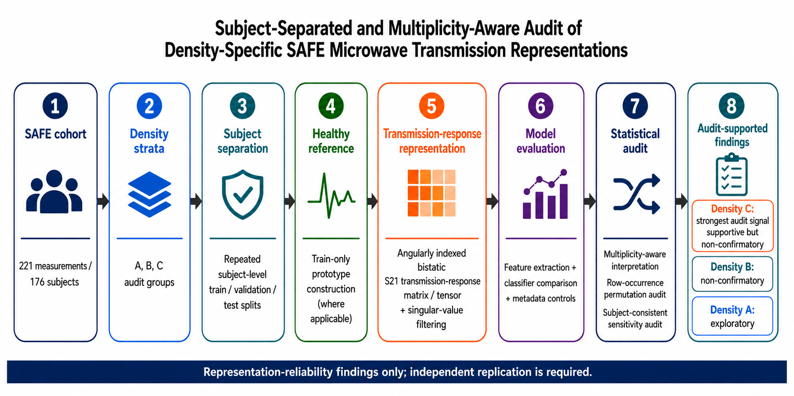


## Team and contact

**Başak Ekinci — Research Lead and Developer**

Primary contributions: scientific formulation and mathematical modeling; implementation of the classical PINN and four-qubit QAPINN models; quantum-circuit ablation studies; development of parameter-matched classical controls; numerical experiments; Fourier/spectral and representation analyses; robustness testing; scientific interpretation; documentation; figure preparation; GitHub organization; and presentation development.

**Contact:** `baekinci@gmail.com`

> **Submission check:** Replace the placeholder above with the email address you want reviewers to use before making the repository public.

---

## Main finding

A four-qubit ring QAPINN improved nonlinear Burgers learning relative to a plain classical bottleneck. That improvement, however, did **not** survive a stronger parameter-matched classical control. A fixed classical trigonometric feature map reproduced much of the quantum representation geometry, achieved lower average error in the strongest matched robustness experiment, and was substantially cheaper to train under ideal state-vector simulation.

> **Useful nonlinear structure was found, but no robust quantum-specific advantage was demonstrated.**

This is a mechanism-attribution result. It is **not** a claim about quantum hardware speedup, asymptotic complexity, or noisy-device performance.

---

## 1. Benchmarks

### Heat equation

$$u_t=\alpha u_{xx},\qquad u(x,0)=\sin(\pi x),\qquad
u(0,t)=u(1,t)=0.
$$

The exact solution is

$$u(x,t)=e^{-\alpha\pi^2t}\sin(\pi x).
$$

Heat provides a smooth, spectrally simple implementation/control benchmark.

### Viscous Burgers equation

$$u_t+u u_x=\nu u_{xx},\qquad
\nu=\frac{0.01}{\pi},
$$

with

$$u(x,0)=-\sin(\pi x),\qquad
u(-1,t)=u(1,t)=0.
$$

Burgers is nonlinear because of the `u u_x` term and generates richer mode interactions than Heat.

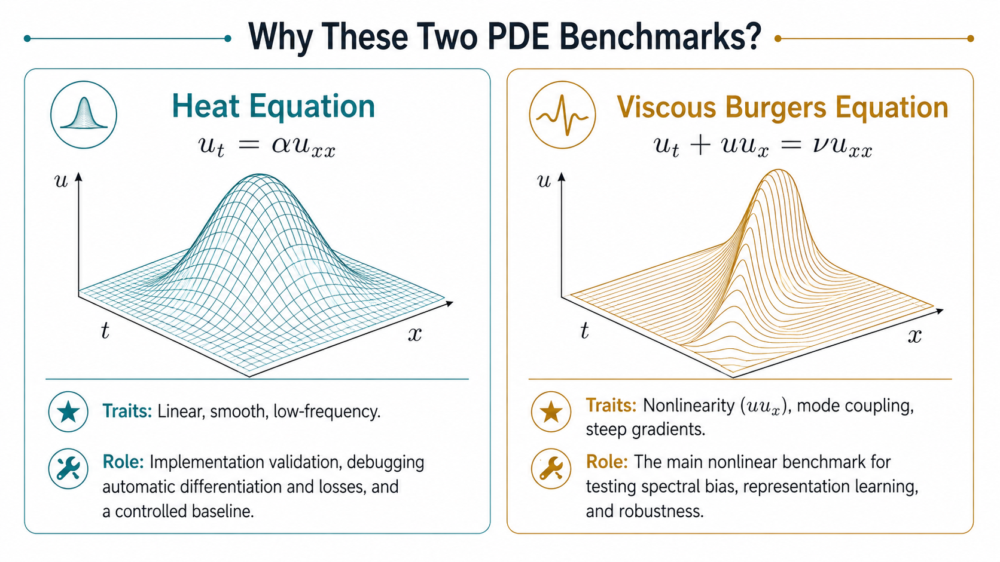

### Reference and diagnostics are deliberately separated

- The **PINN/QAPINN learns** `u_theta(x,t)` by minimizing PDE, initial-condition, and boundary-condition losses.
- The **Cole-Hopf transformation + stabilized Gauss-Hermite quadrature** generates an independent Burgers reference solution for evaluation. It is not used by the neural network to learn the PDE.
- **Fourier analysis** diagnoses where the learned solution is accurate in spatial-frequency space (low, middle, high bands). It is not the PDE solver.

See [`docs/SCIENTIFIC_INTERPRETATION.md`](docs/SCIENTIFIC_INTERPRETATION.md).

---

## 2. Models and fair controls

The main controlled architectures are:

| Model | Middle representation | Trainable parameters |
|---|---|---:|
| Classical bottleneck | 4-D tanh bottleneck | 109 |
| Classical local trigonometric | fixed 4-D periodic map | 109 |
| Quantum, no entanglement | 4-qubit VQC, no CNOT | 125 |
| Quantum, trainable ring | 4-qubit VQC, ring CNOTs | 125 |
| Quantum, frozen ring | fixed 4-qubit ring feature map | 109 |

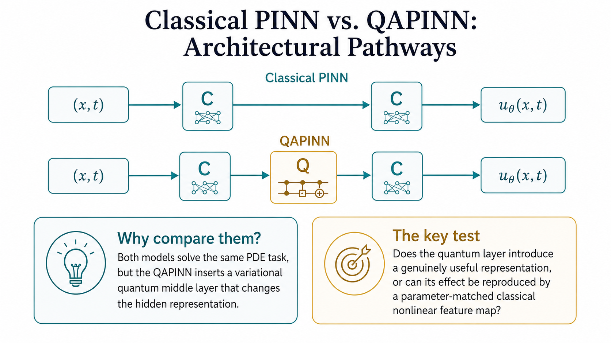

### Actual quantum circuit used

The reported circuit is **four qubits, depth 2**:

1. `(x,t) -> Linear(2,8) -> tanh -> Linear(8,4) -> tanh` produces four encoding angles.
2. One `RY(phi_i)` data-encoding rotation is applied to each qubit.
3. At each of two depths, every qubit receives trainable `RY(theta[l,i])` and `RZ(omega[l,i])` rotations.
4. The ring variant applies CNOTs `(0->1), (1->2), (2->3), (3->0)`.
5. `<Z0>, <Z1>, <Z2>, <Z3>` are measured and passed through `Linear(4,8) -> tanh -> Linear(8,1)`.

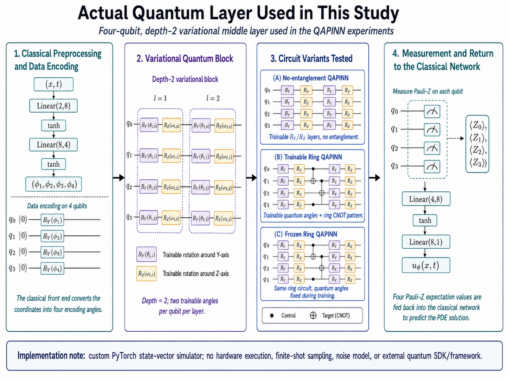

Implementation: **custom differentiable PyTorch state-vector simulation**. The reported study has no quantum hardware execution, finite-shot sampling, device-noise model, or external quantum SDK/framework.

Exact specification: [`docs/CIRCUIT_SPEC.md`](docs/CIRCUIT_SPEC.md).

---

## 3. Headline results

### Heat: controlled four-model pilot

| Model | Relative L2 | Mean time |
|---|---:|---:|
| **Classical bottleneck** | **0.6106 ± 0.0579** | **0.27 s** |
| Quantum, no entanglement | 0.6605 ± 0.0284 | 5.09 s |
| Quantum, trainable ring | 0.6501 ± 0.0354 | 4.44 s |
| Quantum, frozen ring | 0.6504 ± 0.0310 | 5.36 s |

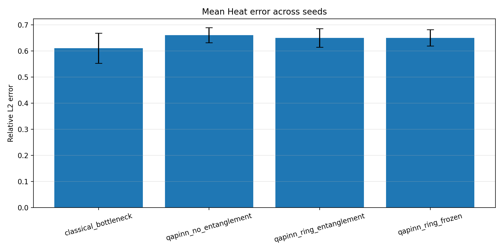

Heat showed no quantum benefit. Trainable and frozen ring variants were nearly indistinguishable, and their learned output geometries had CKA approximately `0.999`.

### Burgers: the apparent quantum gain

For 500 epochs with initial-condition weight `w_IC = 10`:

| Model | Relative L2 |
|---|---:|
| Classical bottleneck | 0.6500 ± 0.0831 |
| Quantum, no entanglement | 0.5911 ± 0.0141 |
| Quantum, trainable ring | 0.5339 ± 0.0485 |
| Quantum, frozen ring | 0.5252 ± 0.0655 |

The ring circuit therefore **did** improve over the plain classical bottleneck.

But that comparison alone cannot identify a quantum-specific mechanism, because replacing the middle layer also changes periodicity, nonlinear feature geometry, and inductive bias.

### Stronger classical mimicry control

A parameter-matched classical periodic map was therefore introduced:

| Model | Trainable parameters | Relative L2 | Mean time |
|---|---:|---:|---:|
| Classical bottleneck | 109 | 0.6500 ± 0.0831 | 2.04 s |
| **Classical local trigonometric** | **109** | **0.4719 ± 0.0348** | **2.08 s** |
| Classical ring trigonometric | 109 | 0.5857 ± 0.0597 | 2.28 s |
| Quantum, no entanglement | 125 | 0.5911 ± 0.0141 | 25.42 s |
| Quantum, trainable ring | 125 | 0.5339 ± 0.0485 | 25.06 s |
| Quantum, frozen ring | 109 | 0.5252 ± 0.0655 | 18.26 s |

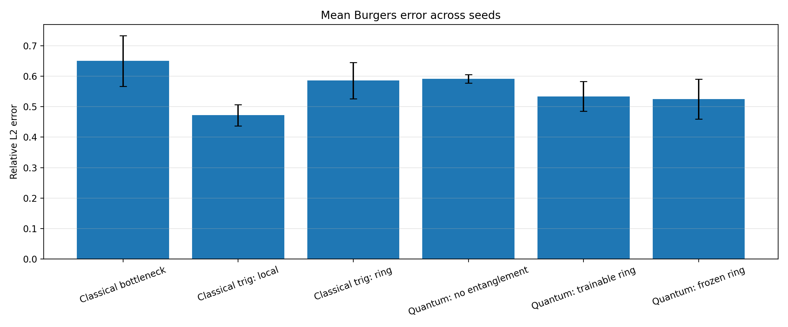

The classical local trigonometric map beat the frozen quantum model in all three initial architecture seeds.

---

## 4. What did the middle layers represent?

The representation audit used a common `41 x 41` space-time grid (`1681` points).

Primary output representations:

| Representation | Effective rank | Mean absolute correlation |
|---|---:|---:|
| Classical bottleneck | 1.390 ± 0.308 | 0.731 |
| **Classical local trig** | **2.079 ± 0.229** | **0.532** |
| Frozen quantum ring | 1.602 ± 0.473 | 0.685 |

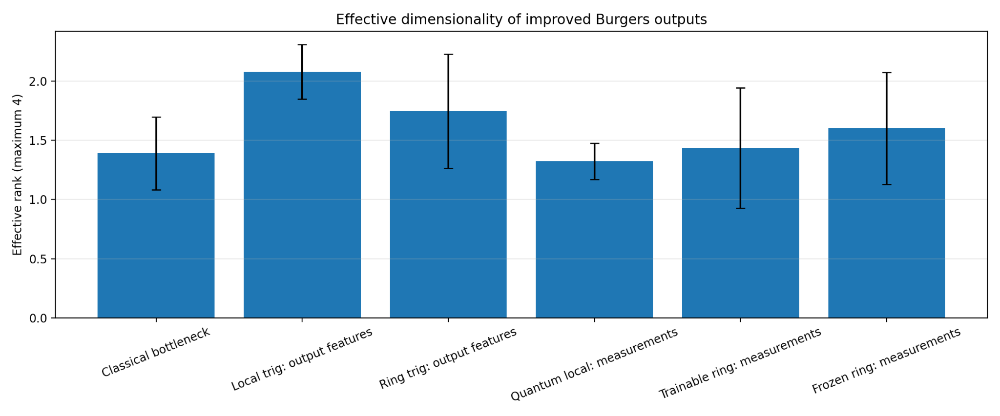

The classical local-trigonometric and frozen-quantum outputs had

$$
\mathrm{CKA}=0.936\pm0.050.
$$

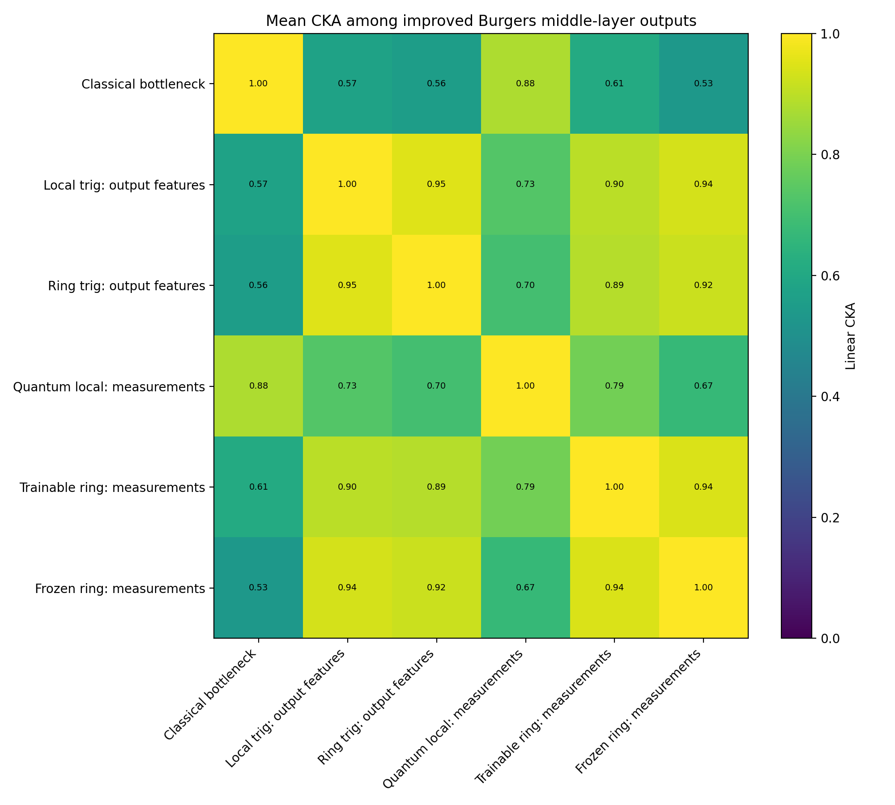

This is the key attribution result: the best classical periodic control reproduced much of the quantum representation geometry while retaining more independent feature directions.

---

## 5. Final matched robustness study

The strongest comparison separated three sources of variation:

- data seeds: `11, 22`;
- model-initialization seeds: `777, 888, 999, 1111`;
- phase seeds: `101, 303`.

That gives

$$
2\times4\times2=16
$$

matched classical-vs-frozen-quantum cells. Within each pair, the models shared training coordinates, surrounding classical initialization, the same 16 phase values, optimizer, budget, and **109 trainable parameters**.

| Model | Relative L2 | Mean training time |
|---|---:|---:|
| **Classical local trig** | **0.4475 ± 0.0411** | **2.99 s** |
| Frozen quantum ring | 0.4887 ± 0.0698 | 26.58 s |

The classical map won **14 of 16** matched cells. All four model-seed blocks favored it on average. With only four independent model-initialization blocks, the exact two-sided block sign test was `p = 0.125`, so this is robustness evidence rather than formal confirmation.

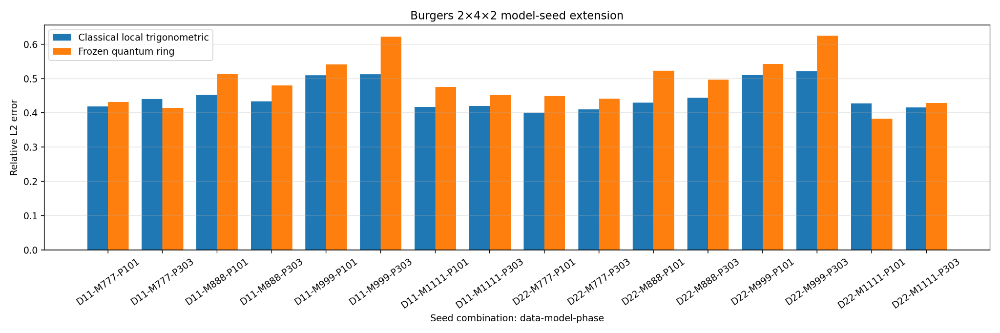

### Spectral fidelity at `t = 0.5`

| Frequency band | Classical local trig | Frozen quantum ring |
|---|---:|---:|
| Low | **0.51985 ± 0.03844** | 0.55401 ± 0.06474 |
| Middle | **0.05485 ± 0.00198** | 0.05593 ± 0.00223 |
| High | **0.01431 ± 0.00348** | 0.01612 ± 0.00355 |

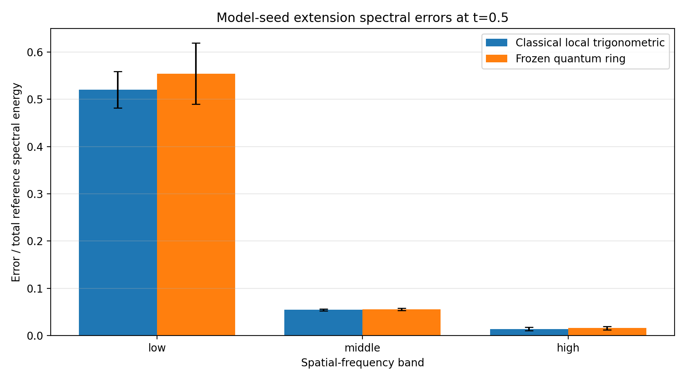

The classical map was better on average in all three spectral bands.

### Runtime

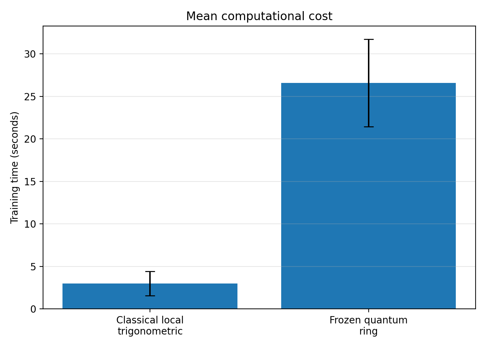

Under the exact four-qubit state-vector implementation, the frozen quantum model was approximately **8.9x slower** than the classical periodic control. This is a simulator-cost observation, not a statement about future hardware complexity.

---

## 6. Scientific conclusion

The evidence supports three increasingly strong statements:

1. **Architecture-level result:** the four-qubit ring QAPINN can outperform a plain classical bottleneck on nonlinear Burgers.
2. **Mechanism-level result:** ring connectivity and periodic nonlinear structure are useful in this benchmark; training the quantum angles is not consistently necessary.
3. **Quantum-specificity result:** the improvement cannot presently be attributed to a uniquely quantum mechanism, because a parameter-matched classical periodic feature map reproduces much of the geometry and performs better under the strongest matched comparison.

In short:

> **The quantum layer helped reveal a useful inductive bias; the controlled evidence indicates that this bias is reproducible classically.**

---


## 7. Data, software, and credits

### Data and reference solutions

This project uses **no confidential, proprietary, personal, classified, export-controlled, or restricted datasets**.

- The Heat-equation target is generated analytically from its exact solution.
- The Burgers reference solution is self-generated from the Cole--Hopf formulation and evaluated numerically using stabilized Gauss--Hermite quadrature.
- PINN collocation points, initial-condition points, boundary-condition points, and matched experimental coordinates are generated synthetically by the project scripts.
- The compact validated Burgers reference grid committed under `data/` can be regenerated using the provided script.

### Software and external tools

The implementation uses:

- **Python**
- **PyTorch** for neural-network training, automatic differentiation, and the custom differentiable four-qubit state-vector simulator
- **NumPy** for numerical array operations
- **Matplotlib** for scientific plotting
- **pytest** for automated validation

The reported quantum experiments do **not** use an external quantum SDK/framework or quantum hardware. The four-qubit circuit is implemented directly in PyTorch as an exact ideal state-vector simulation.

### Scientific methods and attribution

The project builds on established methods including Physics-Informed Neural Networks, the Cole--Hopf transformation for the viscous Burgers equation, Gauss--Hermite quadrature for numerical reference evaluation, Fourier/spectral diagnostics, and centered kernel alignment (CKA) for representation comparison.

Full bibliographic references and methodological context are provided in:

- [`docs/WISER_BQP_Technical_Report.pdf`](docs/WISER_BQP_Technical_Report.pdf)
- [`docs/SCIENTIFIC_INTERPRETATION.md`](docs/SCIENTIFIC_INTERPRETATION.md)
- [`docs/CIRCUIT_SPEC.md`](docs/CIRCUIT_SPEC.md)

---

## 8. Reproducibility

### Environment

Python 3.11+ is recommended. CPU execution is sufficient for the four-qubit state-vector experiments.

```bash
python -m venv .venv
source .venv/bin/activate
pip install -e ".[dev]"
pytest
```

### Generate the Burgers reference grid

A compact validated reference grid is already committed under `data/`, but it can be regenerated:

```bash
python -m scripts.generate_burgers_reference
```

### Selected experiment entry points

```bash
# Heat quantum ablation
python -m scripts.compare_quantum_ablations_heat

# Improved Burgers training
python -m scripts.train_burgers_improved

# Burgers quantum ablations
python -m scripts.compare_burgers_quantum_ablations_improved

# One separated-seed matched cell
python -m scripts.run_burgers_factorial_pair \
  --data-seed 11 \
  --model-seed 777 \
  --phase-seed 101 \
  --output-root outputs/factorial
```

The historical comparison/analysis scripts are included because they document the actual path from pilot experiments to the final matched study. Generated outputs belong under `outputs/`, which is ignored by git.

### Regenerate compact summary figures

The committed figures are the actual final report plots. A lightweight summary plotting helper is also included:

```bash
python -m scripts.plot_final_results
```

---

## 9. Repository structure

```text
.
├── README.md
├── REPOSITORY_MAP.md
├── pyproject.toml
├── requirements.txt
├── quantum_layer.py
├── classical_bottleneck.py
├── classical_trigonometric.py
├── classical_mlp.py
├── heat.py
├── burgers.py
├── derivatives.py
├── losses.py
├── spectra.py
├── train_heat.py
├── train_burgers.py
├── data/
│   └── burgers_reference.npz
├── scripts/
├── tests/
├── results/
├── figures/
│   ├── conceptual/
│   └── results/
├── docs/
│   └── WISER_BQP_Technical_Report.pdf
└── outputs/
```

See [`REPOSITORY_MAP.md`](REPOSITORY_MAP.md) for the annotated map.

---

## 10. Evidence boundaries

- Heat and the initial Burgers architecture experiments use three seeds.
- The final Burgers extension has 16 matched cells but only four independent model-initialization blocks.
- Data and phase factors use two selected levels each.
- The backend is exact ideal state-vector simulation: no finite shots, device noise, queueing, calibration drift, or hardware constraints.
- Lower sampled PINN training loss is not treated as equivalent to lower dense-grid solution error.
- Runtime comparisons describe this implementation only.
- **No claim of quantum advantage is made.**

For the full evidence trail, read:

- [`docs/FINAL_BENCHMARKS.md`](docs/FINAL_BENCHMARKS.md)
- [`docs/EXPERIMENT_MATRIX.md`](docs/EXPERIMENT_MATRIX.md)
- [`docs/REPRODUCIBILITY.md`](docs/REPRODUCIBILITY.md)
- [`docs/SCIENTIFIC_INTERPRETATION.md`](docs/SCIENTIFIC_INTERPRETATION.md)
- [`docs/WISER_BQP_Technical_Report.pdf`](docs/WISER_BQP_Technical_Report.pdf)
- [`docs/FIGURE_INDEX.md`](docs/FIGURE_INDEX.md)
- [`docs/VALIDATION.md`](docs/VALIDATION.md)

---

## 11. Future direction

The next scientifically defensible progression is to keep the same strong-control philosophy while increasing physical complexity: coupled/higher-dimensional PDEs, then candidate application classes such as CFD, plasma/MHD, and materials transport, and finally inverse problems with sparse/noisy observations.

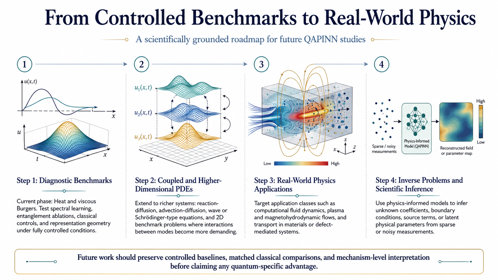

The benchmark should become harder **without weakening the classical baselines, matched comparisons, or mechanism-level interpretation**.

---


